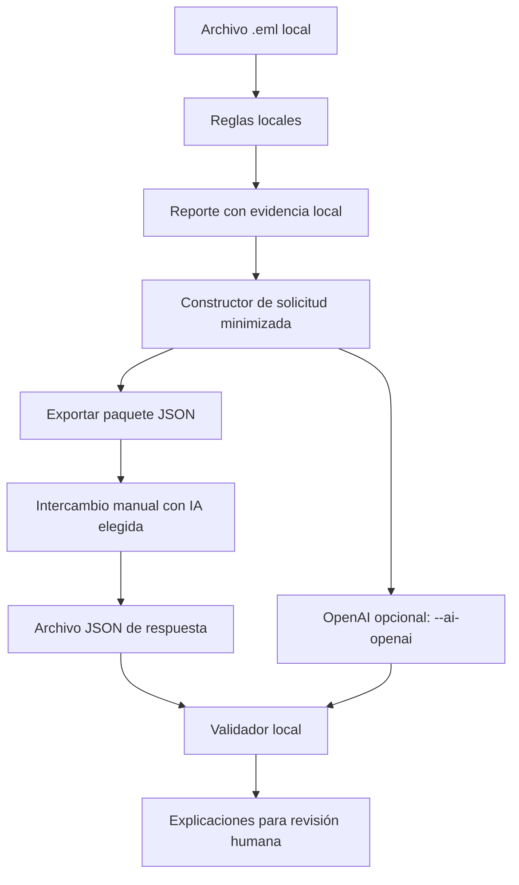

# Arquitectura de la explicación asistida por IA

La versión 0.2 agrega una capa opcional que explica señales ya producidas por reglas locales. El diseño separa tres responsabilidades: producir hallazgos, generar explicaciones y validar la respuesta recibida.

## Flujo de datos



La demo guardada entra por el mismo camino que un archivo de respuesta. Reproducirla no vuelve a consultar un modelo.

## 1. Productor de hallazgos

El analizador lee el correo y aplica reglas deterministas. El reporte local puede incluir encabezados, enlaces desactivados, nombres de adjuntos, evidencia y el hash del archivo. Esos campos quedan fuera de la solicitud de IA.

Las reglas disponibles son:

| Identificador | Observación que puede explicar la IA |
| --- | --- |
| `reply_to_domain` | From y Reply-To tienen dominios completos distintos. |
| `urgent_subject` | El asunto contiene una expresión del conjunto de urgencia. |
| `link_label_mismatch` | Un enlace HTML muestra un dominio y apunta a otro. |
| `executable_attachment` | Un nombre de adjunto termina en una extensión supervisada de ejecución. |
| `http_link` | Se encontró un enlace HTTP sin cifrado de transporte. |
| `ip_link` | Un enlace usa una dirección IP como host. |
| `userinfo_link` | Un enlace contiene información de usuario antes de `@`. |

Cada regla tiene límites y puede activarse en un contexto legítimo. La capa de IA no debe agregar hallazgos ni convertirlos en un veredicto.

## 2. Solicitud minimizada

El constructor admite únicamente reglas conocidas y asigna identificadores locales como `F001`. Para cada hallazgo copia el identificador de regla y toma una observación de un catálogo fijo. No copia texto libre procedente del correo.

El paquete exportado contiene:

- `request_id`: hash de los hechos minimizados y de la versión del contrato.
- `findings`: objetos con `finding_id`, `rule` y `observation`.
- `instructions`: instrucciones para generar explicaciones y comprobaciones manuales.
- `response_schema`: estructura esperada de la respuesta.

**No se incluyen encabezados, cuerpo, evidencias, URL ni el SHA-256 del correo.** El `request_id` no es un identificador forense del mensaje. Correos diferentes que activen la misma secuencia de reglas pueden producir el mismo identificador de solicitud.

Este recorte limita los datos compartidos y la exposición del generador a instrucciones que pudiera contener un correo. No constituye una demostración de resistencia universal a prompt injection.

## 3. Generador de explicaciones

Hay tres recorridos:

| Modo | Generación de texto | Red desde el programa |
| --- | --- | --- |
| `--ai-response archivo.json` | Importa texto ya guardado; no genera una nueva respuesta. | No. |
| `--export-ai-request archivo.json` | Exporta el paquete. La persona puede compartirlo con una IA elegida y guardar la respuesta. | No. El intercambio manual se realiza fuera del programa. |
| `--ai-openai` | Solicita una respuesta mediante Responses API. | Sí, sólo para enviar la solicitud minimizada al proveedor. |

La integración OpenAI requiere `OPENAI_API_KEY` y `OPENAI_MODEL` en variables de entorno. No hay un modelo predeterminado ni carga automática de `.env`. La clave queda fuera del chat, los archivos del proyecto y el repositorio.

Con cero hallazgos, el modo OpenAI omite la consulta. No hay observaciones que explicar.

## 4. Contrato de la respuesta

La respuesta del generador debe ser un objeto JSON con esta estructura. Los valores entre signos `< >` son marcadores explicativos, no una respuesta válida:

```json
{
  "request_id": "<copiar el request_id de la solicitud>",
  "review_required": true,
  "explanations": [
    {
      "finding_id": "F001",
      "rule": "reply_to_domain",
      "explanation": "<explicación de la observación recibida>",
      "manual_checks": ["<comprobación manual sugerida>"]
    }
  ]
}
```

Cada hallazgo debe tener exactamente una explicación. El generador conserva los identificadores y su regla, y propone entre una y tres comprobaciones manuales. `review_required` debe ser `true`.

## 5. Validador local

La respuesta se trata como datos no confiables. El validador comprueba:

- JSON válido, sin claves duplicadas, con los campos permitidos y los tipos esperados.
- Coincidencia de `request_id` con la solicitud minimizada actual.
- Cobertura completa: ningún hallazgo omitido, agregado o duplicado.
- Correspondencia de cada `finding_id` con su `rule` original.
- Presencia de revisión humana y entre una y tres comprobaciones por hallazgo.
- Límites de longitud y caracteres imprimibles.
- Algunos patrones de URL, correo, IP y otros indicadores que el generador no debería introducir.

El alcance actual es de hasta 80 hallazgos y archivos de respuesta de hasta 256 KiB. Las explicaciones admiten de 15 a 700 caracteres; cada comprobación admite hasta 300. Estos son límites de implementación, no medidas de calidad semántica.

El control de indicadores usa patrones parciales. No detecta toda dirección posible, todos los hechos inventados ni todas las formas de contenido engañoso.

**La validación no demuestra la verdad del texto.** Una afirmación falsa puede conservar identificadores, respetar el esquema y pasar los controles. La revisión humana debe comprobar el sentido de la explicación y su relación con las observaciones.

## 6. Evaluación y evidencia disponible

Las pruebas del analizador comprueban reglas con correos ficticios. La suite `evals/offline_suite.py` trabaja con entradas y respuestas sintéticas para evaluar el contrato, la minimización y los rechazos previstos.

Los resultados se registran en [EVALUACION.md](EVALUACION.md) y [EVALUACION.json](EVALUACION.json). La suite también expone el límite semántico mediante texto falso que conserva la estructura y las referencias. Aceptar ese texto demuestra una limitación del validador; no acredita que la explicación sea correcta.

Los casos sintéticos no constituyen un benchmark con correos reales. Tampoco evalúan la tasa de acierto, la disponibilidad ni la calidad de un modelo remoto.

La respuesta de demostración fue preparada por el asistente durante el desarrollo; su origen se documenta en [PROVENIENCIA_IA.md](PROVENIENCIA_IA.md). Importarla sólo permite revisar una respuesta guardada.

**Integración HTTP real:** no hay una prueba exitosa de generación por API en vivo. El recorrido principal usa `modo_manual.cmd`: prepara un paquete para copiar a un chat e importa la respuesta guardada. Ese asistente no realiza llamadas de red. Las pruebas locales no sustituyen la verificación de una generación por API.

## 7. Uso como ejercicio de auditoría técnica

Este diseño permite estudiar qué datos salen del sistema, qué reglas producen hechos, qué contenido genera la IA y qué comprueba cada control. Un informe de evaluación debería separar los resultados observados de las garantías que el software no ofrece.

Para documentar el aprendizaje, conviene registrar un caso aceptado, uno rechazado y uno semánticamente falso que pase la validación. Eso permite explicar con evidencia el alcance de los controles, sin atribuir una evaluación integral de seguridad o del modelo.

Referencia de la integración: [documentación oficial de OpenAI sobre generación de texto y Responses API](https://developers.openai.com/api/docs/guides/text).
